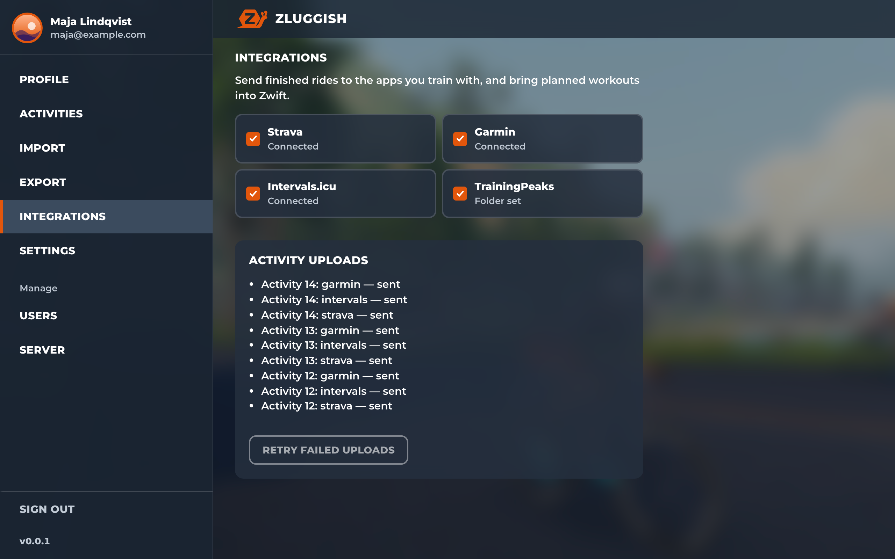

# Share activities

Each user manages their own connections under **Integrations** in the [web app](web-app.md).

The server saves each completed activity locally before it uploads it. If an upload to one service fails, the saved activity stays. To send a failed upload again, go to **Integrations → Activity uploads**.

Live authorization and delivery for each service are not fully verified yet.

## Services

- [Strava](integrations/strava.md)
- [Garmin Connect](integrations/garmin.md)
- [Intervals.icu and planned workouts](integrations/intervals-icu.md)
- [Official Zwift uploads and Runalyze](integrations/zwift-and-runalyze.md)

:::warning

Keep your integration credentials private. When you move storage to a new computer, keep the encryption keys.

:::
